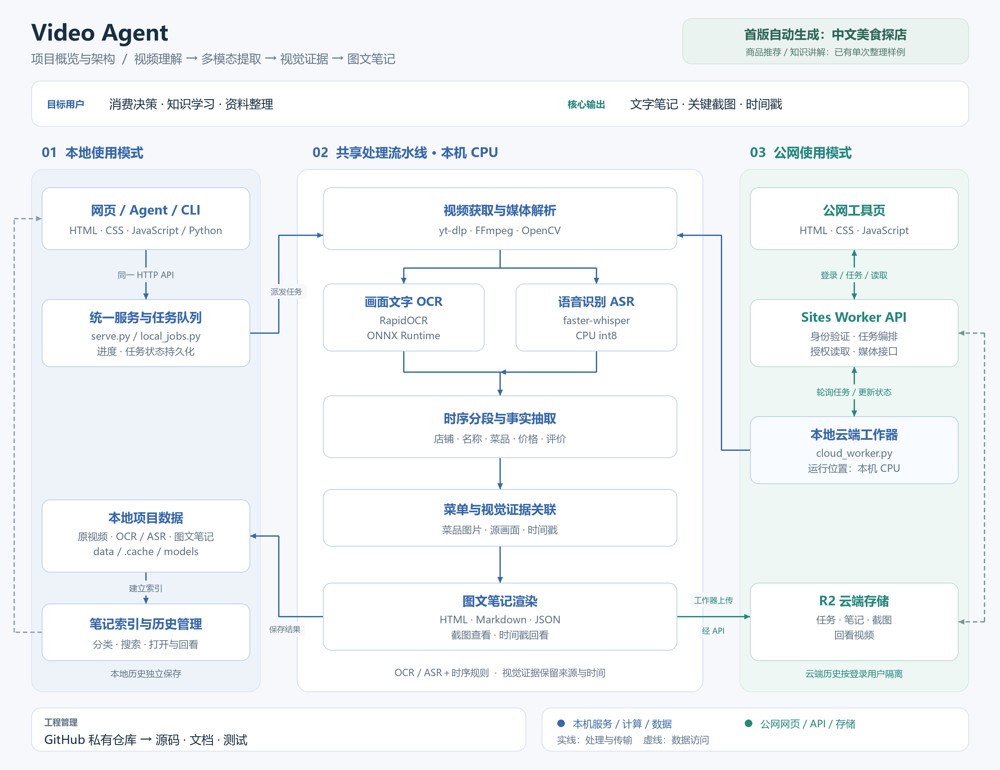
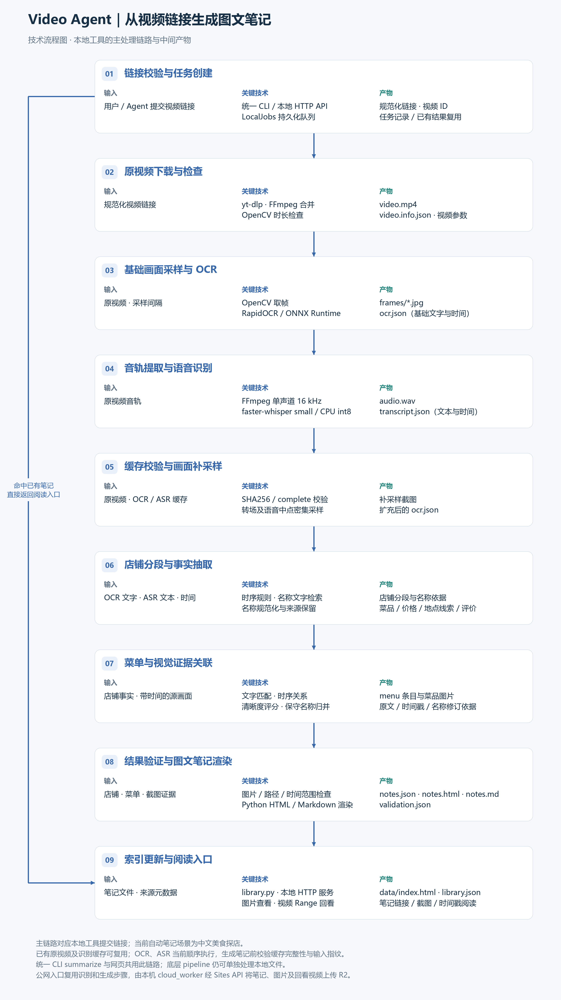

# 项目架构与技术流程

以下绘图和结构说明面向开发维护；日常使用见 [README](../README.md)。命令在项目根目录运行。

## 项目概览与架构

<p align="center">
  
</p>

[查看 PNG 原图](architecture/project-architecture.png) · [SVG 矢量图](architecture/project-architecture.svg) · [绘图源代码](architecture/render_architecture.py)

<details>
<summary>结构与节点关系清单</summary>

### 结构与节点

| 图中位置 | 节点 |
| --- | --- |
| 顶部：目标 | 视频理解 → 多模态信息提取 → 视觉证据关联 → 图文笔记 |
| 顶部：用户 | 消费决策用户 · 知识学习用户 · 视频资料整理用户 |
| 场景层 | 美食探店（自动生成）· 商品推荐与评测／知识讲解（已有单次整理样例） |
| 入口层 | 本地网页 · Agent + 可选 Skill · 统一 CLI；公网工具页为进阶部署 |
| 功能层 | 视频导入 · 任务进度 · 店铺与菜单整理 · 截图与时间戳 · 笔记生成 · 分类／搜索／历史管理 |
| 处理层 | 任务编排 · 视频下载 · 媒体解析 · 画面 OCR · 语音 ASR · 时序分段与事实抽取 · 菜单与截图关联 · 笔记渲染 |
| 数据层 | 原视频与元数据 · OCR／ASR 缓存 · 图片与时间戳 · HTML／Markdown／JSON · 本地任务记录与笔记索引 · 云端任务与结果 |
| 技术层 | HTML／CSS／JavaScript · Python · yt-dlp · FFmpeg／OpenCV · RapidOCR／ONNX Runtime · faster-whisper（CPU int8）· JSON |
| 部署层 | 本地 Python 服务与 CPU 工作器 · Sites Worker · R2 存储 |
| 版本管理 | GitHub 私有仓库 → 源码／测试／文档 |

### 节点关系清单

- 用户 → 本地网页／Agent（可选 Skill）／统一 CLI。
- 本地网页／Agent CLI ↔ 同一本地 HTTP 服务 → 同一任务队列 → 处理流水线。
- 开发用 pipeline CLI → 处理流水线；日常 summarize CLI 通过本地 HTTP 服务。
- 公网工具页 ↔ Sites Worker API ↔ R2 任务与结果。
- 本地云端工作器 → 轮询 Sites Worker 任务 API → 处理流水线。
- 视频链接 → yt-dlp → 原视频与元数据；本地视频 → 处理流水线。
- 原视频 → FFmpeg／OpenCV → 视频画面＋音轨。
- 视频画面 → RapidOCR／ONNX Runtime → OCR 文字与时间。
- 音轨 → faster-whisper → ASR 文本与时间。
- OCR＋ASR → 时序分段与事实抽取 → 店铺／名称／菜品／价格／评价。
- 店铺与事实＋源画面 → 菜单与截图关联 → 笔记渲染 → HTML／Markdown／JSON。
- 本地处理结果 → 本地数据目录 → 笔记索引 → 本地工具页。
- 本地云端工作器 → 上传笔记／截图／回看视频 → Sites Worker API → R2。
- R2 结果 → Sites Worker 授权接口 → 公网工具页。
- 截图／时间戳 → 对应原视频位置 → 视频回看。
- GitHub 私有仓库 → 源码／测试／文档版本管理。

</details>

### 三段式汇报顺序

1. **目标与用户**：长视频 → 图文笔记；消费决策／知识复习／资料整理；美食探店 MVP → 后续场景。
2. **功能与数据流**：视频输入 → OCR＋ASR → 结构化抽取 → 截图关联 → 图文笔记与回看。
3. **技术与部署**：本地 Python 处理 → 本地网页／Sites Worker＋R2 → GitHub 私有仓库版本管理。

## 技术流程图生成

使用通用的配置驱动绘图模块，展示任务从输入到输出的处理链路。每一步包含 **输入、关键技术、中间产物**，支持顺序、分支、汇合及已有结果复用路径。

默认配置对应 Video Agent 本地工具的真实处理链路：链接校验与任务创建 → 下载检查 → 画面 OCR → 音轨 ASR → 缓存校验与补采样 → 店铺事实抽取 → 菜单图片关联 → 验证与渲染 → 索引和阅读入口。

<p align="center">
  
</p>

[PNG 原图](architecture/technical-flow.png) · [SVG 矢量图](architecture/technical-flow.svg) · [步骤配置](architecture/technical-flow.json) · [使用与配置说明](TECHNICAL_FLOW.md)

在项目目录一键重生成：

```powershell
.\.venv\Scripts\python.exe -m video_agent.technical_flow
```

其他任务可复制 [通用分支示例](architecture/technical-flow.example.json)，修改步骤与关系后，通过 `--config` 和 `--output` 生成自己的图；无需修改绘图代码。流程内容由配置提供，生成器负责校验、布局与导出。
