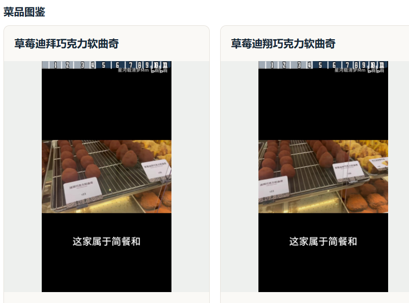
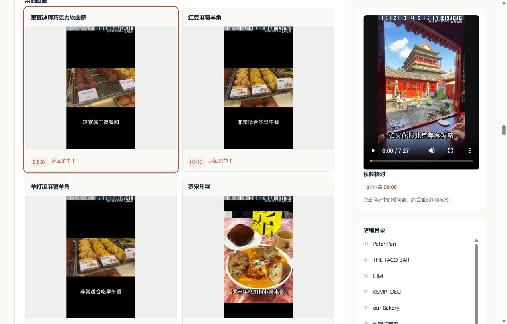

# 项目 BUG 记录

本文件只记录用户明确要求记录的 BUG；助手推荐新增记录时，先由用户确认。不自动收录普通排查过程或其他发现。

## BUG-001 · 同一菜品因 OCR 错字生成两张卡片

- 提出时间：2026-10-07。
- 状态：已修复，已验证原视频样例。
- 位置：our Bakery → 推荐菜单／菜品图鉴。
- 样例：`BV1cHen6EEen`，约 03:06–03:07。

### 问题与预期

修复前同时出现“草莓迪拜巧克力软曲奇”（左侧正确）和“草莓迪翔巧克力软曲奇”（右侧错误）。两张图片实际指向同一商品。预期只显示一个正确菜名、一条菜单项和一张图片卡片。

### 原因分析

相邻帧中的同一商品牌发生单字 OCR 误识别：

| 视频时间 | OCR 文本 | 置信度 |
| --- | --- | --- |
| 186.40 秒 | 草莓迪拜巧克力软曲奇 | 0.9944 |
| 187.20 秒 | 草莓迪翔巧克力软曲奇 | 0.9248 |

事实抽取将两个不同字符串保留为两个候选菜名。菜单阶段此前仅合并同一识别依据中的前缀重复，未处理“拜／翔”这样的单字差异。两个名称分别匹配各自帧，最终渲染为两条菜单项和两张卡片。

### 修复

在 `video_agent/menu.py` 的菜单关联阶段增加有约束的 OCR 名称归并，未将样例菜名写入算法：

- 限于同一店铺内，至少 8 字、等长、仅差一个字符且前三字与后三字一致的名称。
- 对应 OCR 观察相隔不超过 2 秒；两名称若在同一帧同时出现，则不合并。
- 最高置信度至少为 0.98，且两候选最高置信度相差至少 0.04；选高置信度名称作为显示名称。
- 保留 `menu.aliases`、两次原始文字、来源及时间；原始 `dishes` 和 `fact_evidence` 不覆盖。
- 简介中的菜品列表同步使用合并后的菜单名，避免简介继续出现重复名称。

这些规则是保守的识别修订策略，置信度并不等于事实正确率；无法满足条件的名称保留分开，不扩大自动合并范围。

### 修复前后对比

左侧为用户提供的修复前截图；右侧为修复后实际网页截图。右侧第二张卡片现在是另一道菜“红豆麻薯羊角”，错误的“草莓迪翔…”卡片已经消失。

| 修复前 | 修复后 |
| --- | --- |
|  |  |

### 验证结果

- 完整回归：47 passed，39 subtests passed。
- 新增回归覆盖：单字误识别合并、高置信度名称胜出、保留两份原始依据；同帧同时出现、时间相隔过远、置信度不足均不合并。
- 原视频缓存重建通过：11 家店，93 张去重关联截图；图片可读，时间范围有效。
- JSON 断言：正确名称恰好一项，错误名称不再作为菜单项，简介不含错误别名。
- 浏览器：our Bakery 菜品图鉴只出现一张该商品卡片，已保存修复后截图。

### 相关文件

- [菜单处理](../video_agent/menu.py)
- [简介与笔记渲染](../video_agent/render.py)
- [菜单回归测试](../tests/test_menu.py)
